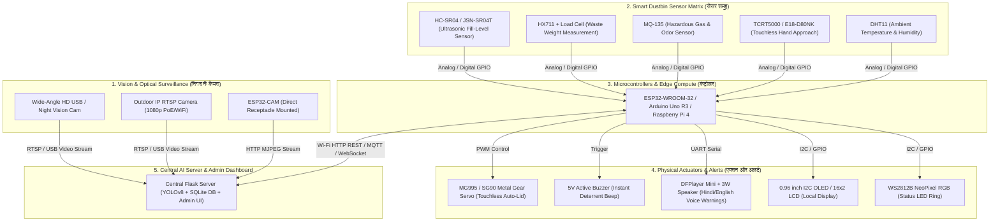

# Smart Waste Detection & IoT Surveillance System - Hardware Components Master Guide
## (स्मार्ट कचरा निगरानी एवं डस्टबिन सिस्टम - हार्डवेयर कंपोनेंट्स संपूर्ण मार्गदर्शिका)

इस प्रोजेक्ट (**AI-Powered Waste Detection & Illegal Dumping Surveillance System**) में कंप्यूटर विजन (YOLOv8 + ByteTrack) सॉफ्टवेयर के साथ-साथ फिजिकल एनवायरनमेंट में निगरानी और स्मार्ट डस्टबिन ऑटोमेशन के लिए विभिन्न **IoT और एम्बेडेड हार्डवेयर कंपोनेंट्स** का उपयोग किया जाता है।

यह फोल्डर सभी आवश्यक हार्डवेयर कंपोनेंट्स, उनके तकनीकी विनिर्देश (Specifications), पिनआउट वायरिंग, सर्किट डायग्राम, वर्किंग फर्मवेयर (ESP32/Arduino/Raspberry Pi) और बिल ऑफ मैटेरियल्स (BOM) का पूरा संग्रह प्रदान करता है।

---

## 🏗️ सम्पूर्ण सिस्टम हार्डवेयर आर्किटेक्चर (System Architecture)



---

## 📦 हार्डवेयर कंपोनेंट्स का वर्गीकरण (Component Categorization)

### 1. विजन एवं कैमरा सिस्टम (Vision & Camera Modules)
* **Wide-Angle USB Night Vision Camera (1080p, 120° FOV, IR-Cut):** कमरे या परिसर में प्राइमरी एआई डिटेक्शन के लिए। रात में 850nm IR LEDs के साथ स्पष्ट वीडियो कैप्चर करता है।
* **Outdoor RTSP IP Bullet Camera (Hikvision / Tapo / Dahua):** सार्वजनिक स्थानों, पार्कों या सड़कों पर 24/7 लंबी दूरी की निगरानी के लिए ONVIF/RTSP प्रोटोकॉल सपोर्ट।
* **ESP32-CAM (OV2640 2MP):** डस्टबिन के ऊपर सीधे माउंट होने वाला अल्ट्रा-लो कॉस्ट माइक्रो-कैमरा जो डस्टबिन के अंदर/बाहर का दृश्य कैप्चर करता है।

### 2. माइक्रोकंट्रोलर्स और एज कंप्यूटिंग (Microcontrollers & Edge Processors)
* **ESP32 DevKit V1 (30-pin, Dual-Core 240MHz):** बिल्ट-इन वाई-फाई और ब्लूटूथ के साथ मुख्य IoT कंट्रोलर जो सेंसर डेटा को सीधे फ्लास्क बैकएंड (`/api/hardware_telemetry`) पर भेजता है।
* **Arduino Uno R3 / Nano (ATmega328P):** विश्वसनीय 5V एनालॉग सेंसर रीडिंग्स (MQ-135, Load Cell) और सर्वो मोटर कंट्रोल के लिए।
* **Raspberry Pi 4 Model B (4GB / 8GB) / Raspberry Pi 5:** स्टैंडअलोन एज हब जहां कैमरा, एआई मॉडल और स्थानीय हार्डवेयर एक ही डिवाइस पर काम कर सकते हैं।
* **NVIDIA Jetson Nano / Orin Nano:** रियल-टाइम GPU टेन्सरआरटी इन्फरेंस के लिए हाई-एंड एज सॉल्यूशन।

### 3. स्मार्ट डस्टबिन सेंसर्स (Smart Receptacle Sensors)
* **HC-SR04 / JSN-SR04T Waterproof Ultrasonic Sensor:** डस्टबिन के ढक्कन पर नीचे की तरफ लगाया जाता है। यह कचरे की ऊंचाई मापकर **Fill Percentage (0% से 100%)** की सटीक गणना करता है।
* **HX711 24-bit ADC + 10kg/20kg Load Cell:** डस्टबिन के बेस पर कचरे का वास्तविक वजन (Weight in kg) मापने के लिए, जिससे सूखे और गीले कचरे का विश्लेषण संभव होता है।
* **MQ-135 Air Quality & Gas Sensor:** सड़े हुए जैविक कचरे से निकलने वाली हानिकारक गैसों (Ammonia $NH_3$, Sulfide $H_2S$, Methane $CH_4$) और बदबू का स्तर मापता है।
* **TCRT5000 / E18-D80NK IR Proximity Sensor:** उपयोगकर्ता के हाथ को 5-15cm की दूरी से डिटेक्ट करके बिना छुए ढक्कन खोलने (Touchless Lid) का कार्य करता है।
* **DHT11 / DHT22 Sensor:** डस्टबिन के आंतरिक तापमान और आर्द्रता (Humidity) की निगरानी।

### 4. एक्ट्यूएटर्स और फिजिकल अलर्ट्स (Actuators & Physical Alerts)
* **MG995 / SG90 180° Metal Gear Servo Motor:** बिना हाथ लगाए डस्टबिन का ढक्कन स्वतः 90 डिग्री खोलने और 5 सेकंड बाद बंद करने के लिए।
* **5V High-Decibel Active Buzzer (85dB+):** अवैध कचरा फेंकने (Illegal Dumping) पर तत्काल तेज बीप चेतावनी देने के लिए।
* **DFPlayer Mini MP3 Player Module + 3W 8Ω Speaker:** एसडी कार्ड में स्टोर की गई हिंदी/अंग्रेजी आवाज में वास्तविक समय पर चेतावनी प्रसारित करना (*"कृपया कचरा डस्टबिन में डालें, गंदगी फैलाना मना है!"*)।
* **0.96" I2C OLED Display (SSD1306, 128x64) / 16x2 I2C LCD:** डस्टबिन के बाहर लाइव जानकारी प्रदर्शित करना (जैसे `Fill: 45% | Air: Clean | Status: OK`)।
* **WS2812B NeoPixel RGB LED Strip/Ring:** 
  - 🟢 **हरा (Green):** डस्टबिन खाली / सामान्य (0% - 74%)
  - 🟡 **पीला (Yellow):** डस्टबिन भरने वाला है (75% - 89%)
  - 🔴 **लाल ब्लिंकिंग (Red Flashing):** डस्टबिन फुल / ओवरफ्लो अलार्म (90%+) या इलीगल डंपिंग अलर्ट।

### 5. पावर सप्लाई और सोलर मैनेजमेंट (Power & Energy Management)
* **12V 2A DC Power Adapter:** मुख्य 220V AC से 12V DC पावर सप्लाई।
* **LM2596 DC-DC Step-Down Buck Converter (12V to 5V 3A):** सर्वो मोटर और माइक्रोकंट्रोलर को स्थिर 5V 3A करंट देने के लिए।
* **18650 3.7V Li-ion Rechargeable Battery Pack (2S with 8.4V BMS):** बिजली गुल होने पर बैकअप पावर।
* **10W / 20W Polycrystalline Solar Panel + TP4056 / CN3791 Solar Charger:** सार्वजनिक पार्कों और सड़कों के लिए 100% सोलर पावर्ड ऑफ-ग्रिड स्मार्ट डस्टबिन।

### 6. एन्क्लोजर और माउंटिंग (Enclosure & Weatherproofing)
* **IP65 Weatherproof ABS Junction Box:** बारिश, धूल और धूप से सभी सर्किट्स की सुरक्षा।
* **Custom 3D Printed Sensor Mounts:** डस्टबिन लिड पर अल्ट्रासोनिक और सर्वो के लिए माउंटिंग क्लैंप्स।

---

## 📁 फोल्डर संरचना (Directory Structure)

```
hardware components/
│
├── README.md                          <-- (आप यहाँ हैं) मुख्य हार्डवेयर गाइड
├── BOM_Bill_Of_Materials.md           <-- सभी कंपोनेंट्स की तालिका, कीमतें और विनिर्देश
├── BOM_Bill_Of_Materials.csv          <-- एक्सेल/स्प्रेडशीट कम्पैटिबल BOM फाइल
├── CIRCUIT_DIAGRAMS.md                <-- कम्पलीट वायरिंग और सर्किट कनेक्शन डायग्राम्स
├── SETUP_AND_WIRING_GUIDE.md          <-- स्टेप-बाय-स्टेप असेंबली, कैलिब्रेशन और टेस्टिंग गाइड
│
├── firmware/                          <-- रेडी-टू-फ्लैश कोड
│   ├── esp32_smart_dustbin.ino        <-- वाई-फाई युक्त ESP32 कोड (सेंसर, सर्वो, HTTP API सिंक)
│   ├── arduino_sensor_node.ino        <-- स्टैंडअलोन Arduino Uno/Nano कोड (सीरियल टेलीमेट्री)
│   └── raspberry_pi_gpio_node.py      <-- रास्पबेरी पाई GPIO पायथन कंट्रोलर
│
└── specifications/                    <-- कंपोनेंट-वाइज विस्तृत टेक्निकल डेटाशीट्स
    ├── 01_VISION_AND_CAMERAS.md       <-- कैमरा और विजन हार्डवेयर
    ├── 02_MICROCONTROLLERS_EDGE.md    <-- ESP32, Arduino, Raspberry Pi, Jetson
    ├── 03_FILL_LEVEL_SENSORS.md       <-- HC-SR04, HX711, MQ-135, IR सेंसर्स
    ├── 04_ACTUATORS_AND_ALERTS.md     <-- सर्वो, बजर, DFPlayer Mini वॉइस
    ├── 05_DISPLAYS_AND_LEDS.md        <-- OLED, LCD 16x2, NeoPixel RGB
    ├── 06_POWER_AND_SOLAR.md          <-- बक कन्वर्टर्स, बैटरी और सोलर किट
    └── 07_ENCLOSURE_AND_MOUNTS.md     <-- IP65 वेदरप्रूफ बॉक्स और 3D माउंट्स
```

---

## ⚡ त्वरित शुरुआत (Quick Start)

1. **सेंसर वायरिंग देखें:** [`CIRCUIT_DIAGRAMS.md`](CIRCUIT_DIAGRAMS.md) खोलें और पिन कनेक्शन चार्ट देखें।
2. **समानों की सूची और बजट देखें:** [`BOM_Bill_Of_Materials.md`](BOM_Bill_Of_Materials.md) देखें (कुल अनुमानित बजट: ₹2,800 से ₹6,500)।
3. **फर्मवेयर अपलोड करें:** Arduino IDE में [`firmware/esp32_smart_dustbin.ino`](firmware/esp32_smart_dustbin.ino) खोलें, अपना Wi-Fi SSID/Password डालें और ESP32 में फ्लैश करें।
4. **एआई डैशबोर्ड से कनेक्ट करें:** ESP32 स्वचालित रूप से फ्लास्क सर्वर के `/api/hardware_telemetry` पर लाइव डेटा भेजेगा और एडमिन पोर्टल के **Dustbin Fill Level** पेज पर रियल-टाइम अपडेट करेगा!

